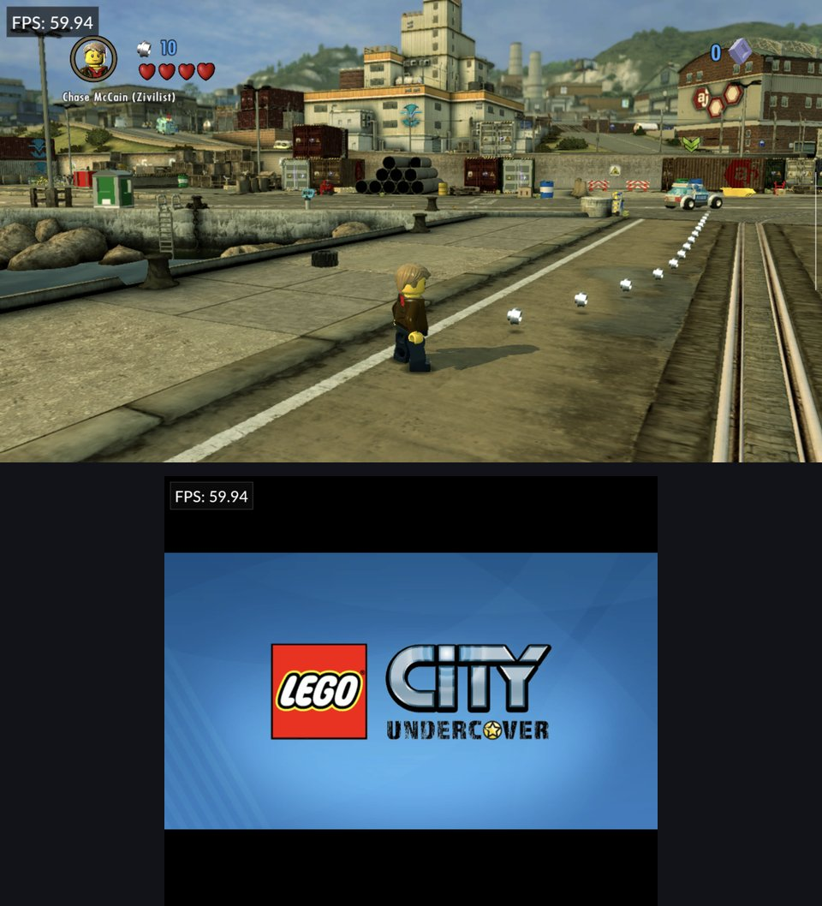
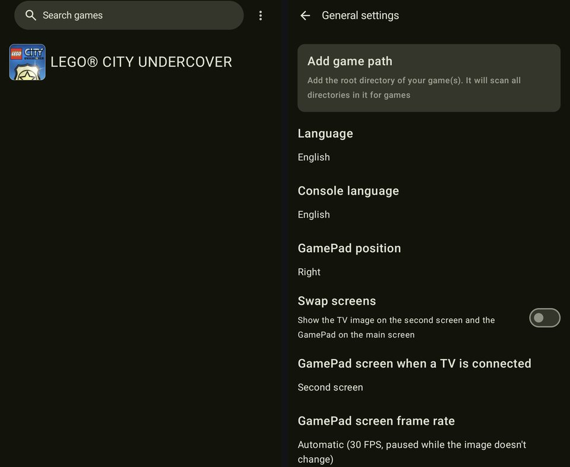
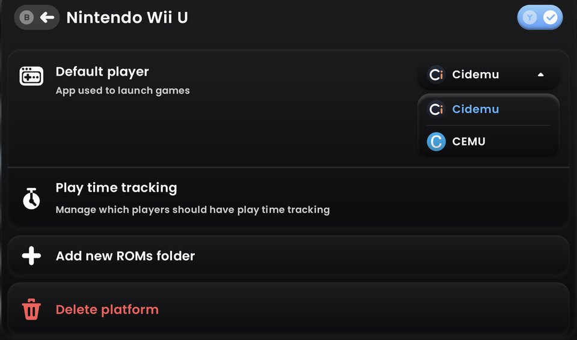

# Cidemu

Cidemu is a Wii U emulator for Android handhelds. It is based on [Cemu](https://github.com/cemu-project/Cemu) and on the [Cemu Android port by SSimco](https://github.com/SSimco/Cemu), and focuses on running games at a steady frame rate with less power and heat on battery-powered devices.

Cidemu is an independent project. It is not affiliated with the Cemu project or with Nintendo. Please don't report Cidemu issues to the Cemu developers.

<p align="center">
  
  
</p>

## Status

Cidemu is early software. Most of the work so far was measured and tested on an AYN Thor (Snapdragon 8 Gen 2, Adreno 740) with LEGO City Undercover. Other games and devices should work as well as they do in the Cemu Android port, but they have seen far less testing. If a game behaves differently in Cidemu than in the Cemu Android port, please open an issue.

## What's different

Changes on top of the Cemu Android port, mostly in the Vulkan renderer and the AArch64 recompiler:

- Render target clears happen inside the next render pass instead of as separate full-image clears. On tile-based mobile GPUs this cut the GPU work in the test scene by about a quarter.
- Consecutive draws to compatible framebuffers stay in one render pass.
- The image is scaled up to the screen by the display hardware instead of a full-resolution copy on the GPU.
- Decoded index data is kept across frames, and command buffers are reset on a separate thread.
- Idle emulated cores and the GPU thread sleep instead of spinning, so the CPU can clock down.
- With the GamePad shown on a second screen, both screens no longer wait on each other every frame.
- The GamePad image can be updated at a lower rate (automatic, full, low), and the TV and GamePad images can be placed on secondary displays. There they cover the launcher of that screen, so it stops drawing in the background.
- Several AArch64 code generation improvements in the recompiler.

## Measurements

All numbers are from an AYN Thor (Snapdragon 8 Gen 2) running LEGO City Undercover (EU, v0) with the 60 FPS graphic pack, the system Vulkan driver and the GamePad image on the second screen, in the harbor with a camera sweep, over the last 70 seconds of each run.

### Cemu Android vs. Cidemu

The Cemu Android port with the Cemu core of November 2026 at stock clocks, the state Cidemu started from, against Cidemu with the [recommended clock limits](#recommended-clock-limits-for-the-ayn-thor):

| | Cemu Android port, stock clocks | Cidemu, recommended limits |
|---|---|---|
| Average frame rate | 55.0 FPS | 59.9 FPS |
| Frames within 16.7 ms | 18 % | 52 % |
| 99th percentile frame time | 23.8 ms | 18.1 ms |
| Frames over 50 ms | 0 | 0 |
| Power of the whole device, on battery | 9.56 W | 6.07 W (−37 %) |
| Hottest CPU core, peak / average | 95 °C / 86 °C | 70 °C / 62 °C |
| GPU temperature, peak | 71 °C | 57 °C |
| Prime core clock, average | 3.19 GHz | 1.95 GHz |

Both were measured the same way, as the power drawn from the battery with the charger unplugged. The Cidemu column is Cidemu 0.2 with its LEGO City Undercover profile.

### Individual changes

Each change compared with the build before it:

| Change | Before | After |
|---|---|---|
| Each screen only waits for its own previous frame | 55.0 FPS, 18 % of frames within 16.7 ms | 59.4 FPS, 51 % of frames within 16.7 ms |
| Idle cores and the GPU thread sleep | 99th percentile frame time 23.6 ms, fastest core always at 3.19 GHz | 19.5 ms, fastest core between 1.84 and 3.19 GHz |
| Clears inside render passes, render pass reuse, scaling by the display hardware, index cache, command buffer reset thread, GamePad frame rate | 7.65 W, 59.1 FPS, 99th percentile 22.4 ms | 6.65 W, 59.9 FPS, 18.1 ms, 28 % less GPU work, about 4 °C cooler |
| LEGO City Undercover profile without the accurate shader multiplication | 6.55 W | 6.28 W, 19 % less GPU work |
| GamePad screen as its own activity | launcher of the second screen keeps drawing about 21 frames per second, 26–37 % of a CPU core | launcher stopped |

The first two rows were measured at stock clocks, as battery power. The others were measured with the CPU and GPU limited the way the device is usually played (prime core 2.09 GHz, middle cores 2.05 GHz, GPU 550 MHz), as the power the whole device draws over USB. Single runs vary by about ±0.2 W, so the power figures are averages of alternating runs.

## Requirements

- Android 11 or newer, 64-bit ARM (arm64-v8a)
- A GPU with Vulkan 1.1
- Your own dumped games and console files (keys, `otp.bin`, `seeprom.bin` for online features). Cidemu does not include any games or Nintendo files.

## Download

APKs are on the [Releases](https://github.com/thisisAcidic/Cidemu/releases) page.

## Getting started

1. Install the APK. Cidemu installs as its own app (`dev.cidix.cidemu`), next to the Cemu Android port if you have it.
2. Open *Settings > General settings > Add game path* and pick the folder with your games. Cidemu finds `.wua`, `.wuhb`, `.wud`, `.wux`, `.iso`, `.rpx` and `.elf` files in it and in its subfolders.
3. Encrypted disc images (`.wud`, `.wux`) need their key in `keys.txt` in the Cidemu folder. *Open Cidemu folder* in the menu of the game list opens it in the system file manager. `otp.bin` and `seeprom.bin` go there as well if you want to use online features.
4. Tap a game to start it. The first start of a game compiles its shaders, later starts reuse them.

### Coming from the Cemu Android port

Your saves, graphic packs, game profiles and shader caches can be taken along. Both apps show their data folder in the system file manager, so copy the contents of the Cemu folder (`mlc01`, `graphicPacks`, `gameProfiles`, `shaderCache`, `controllerProfiles`, `settings.xml`, `keys.txt`, `otp.bin`, `seeprom.bin`) into the Cidemu folder while Cidemu is closed. Add your game path once more afterwards, Android grants folder access to each app separately.

### Settings for handhelds

- *Settings > General settings > GamePad screen frame rate*: *Automatic* only redraws the GamePad image when it changes and at most 30 times per second, which saves power in most games. Use *Always full* if a game shows something on the GamePad that has to move smoothly.
- On dual screen devices the GamePad image goes to the second screen. *Swap screens* in the same place swaps the TV and GamePad images.
- *Shader multiplication accuracy* in a game's profile (long press the game, *Edit game profile*) is on by default because some games need it. Turning it off makes the GPU work noticeably less. Cidemu already turns it off for LEGO City Undercover, which saves about 0.3 to 0.4 W there without visible differences. If a game shows graphical errors with it off, turn it back on.
- *Settings > Graphics settings > Anti-aliasing (FXAA)* smooths jagged edges of the TV image. It only touches pixels on edges, so textures stay sharp.
- *Settings > Graphics settings > Custom drivers* installs Adreno drivers such as Turnip. The system driver is the default and usually the best choice on Snapdragon 8 Gen 2 devices.
- Games start like on the console: the screens turn black, then show the game's boot images with its boot sound until the game shows its own image. *Settings > Audio settings > Boot sound* turns the sound off.

### Recommended clock limits for the AYN Thor

Cidemu was tuned on the AYN Thor with lower clock limits, set with the ClusterTune app:

| ClusterTune | Limit |
|---|---|
| Cluster 7 (prime core) | 2093 MHz |
| Cluster 3 (middle cores) | 2054 MHz |
| Cluster 0 (little cores) | unchanged |
| GPU | 550 MHz |

Together with the changes in Cidemu, LEGO City Undercover keeps a steady 60 FPS with these limits, while the device draws about 3.5 W less and stays about 25 °C cooler than the Cemu Android port at stock clocks, see [Measurements](#measurements). Games that need more performance may drop frames with them, raise the limits again for those.

## Starting games from Cocoon, ES-DE and other frontends

Frontends start Cidemu directly with the game file, the same way as the Cemu Android port. Only the app id is different, so the frontend needs an entry for Cidemu. The frontend also gives Cidemu access to the file, so no game path has to be set up in Cidemu for this. `keys.txt` for encrypted disc images still goes into the Cidemu folder.

### Cocoon

<p align="center">
  
</p>

Cocoon can import platforms from a file, and Cidemu comes with one for the Wii U:

1. Download [`NintendoWiiU-Cidemu.json`](https://github.com/thisisAcidic/Cidemu/releases/latest/download/NintendoWiiU-Cidemu.json) on the device.
2. In Cocoon open *Settings > Library & data*, scroll down to the platform list and press *+* above it.
3. At the very bottom of *Add Platforms* choose *Import Custom Platform* and pick the downloaded file.
4. *Nintendo Wii U* now uses *Cidemu* as default player. CEMU stays available in the same list, and a single game can use another player with *Y > Edit > Player*.
5. If Cocoon has no Wii U games yet, open *Nintendo Wii U* in the platform list, add your Wii U folder with *Add new ROMs folder* and run *Rescan Games*.

Cidemu has also been proposed for Cocoon's own player catalogue. Once it is in there, Cidemu shows up under *Default player* without importing anything.

### ES-DE

ES-DE finds Cemu through a find rule. Save this as `ES-DE/custom_systems/es_find_rules.xml` and restart ES-DE. Its *Cemu (Standalone)* entry then starts Cidemu, or the Cemu Android port while Cidemu isn't installed:

```xml
<?xml version="1.0"?>
<ruleList>
    <emulator name="CEMU">
        <rule type="androidpackage">
            <entry>dev.cidix.cidemu/info.cemu.cemu.emulation.EmulationActivity</entry>
            <entry>info.cemu.cemu/info.cemu.cemu.emulation.EmulationActivity</entry>
        </rule>
    </emulator>
</ruleList>
```

If the file already exists, add the `<emulator>` block to its `<ruleList>`.

### Other frontends

Frontends that let you set up an emulator yourself can start Cidemu with these values:

| Setting | Value |
|---|---|
| Package | `dev.cidix.cidemu` |
| Activity | `info.cemu.cemu.emulation.EmulationActivity` |
| Game | the game file as content URI in the intent data |
| Action | none, or `android.intent.action.VIEW` |
| File types | `.wua`, `.wuhb`, `.wud`, `.wux`, `.iso`, `.rpx`, `.elf` |

The activity needs its full name. The short form `.emulation.EmulationActivity` doesn't work, because the activity lives in the `info.cemu.cemu` package and not in `dev.cidix.cidemu`. As `am start` arguments with the usual placeholder for the game file:

```
-n dev.cidix.cidemu/info.cemu.cemu.emulation.EmulationActivity -a android.intent.action.VIEW -d {file.uri} --activity-clear-task --activity-clear-top
```

## Reporting problems

Open an [issue](https://github.com/thisisAcidic/Cidemu/issues/new/choose) and attach the log: *Share log file* in the menu of the game list shares the `log.txt` of the last run. It helps a lot to know whether the same problem happens in the Cemu Android port.

## Privacy

Cidemu collects no data and has no analytics. It only goes online when you download graphic packs (it asks cemu.info for the current download and fetches the packs from GitHub) and when a game uses online features with the console files and network settings you set up.

## Building

1. `git clone --recursive https://github.com/thisisAcidic/Cidemu`
2. Open `src/android` in Android Studio, or run `./gradlew assembleRelease` in `src/android`.

See [BUILD.md](/BUILD.md) for the other platforms Cemu supports. Release APKs are built by the [Cidemu release workflow](/.github/workflows/android_release.yml) when an `android-vX.Y` tag is pushed.

## Contributing

Bug reports and pull requests are welcome. Changes that are not specific to Android are best proposed to [Cemu](https://github.com/cemu-project/Cemu) directly, see the [contribution guidelines](/CONTRIBUTING.md) and [coding style](/CODING_STYLE.md).

## License

Cidemu, like Cemu, is licensed under the [Mozilla Public License 2.0](/LICENSE.txt). Exempt from this are all files in the dependencies directory for which the licenses of the original code apply as well as some individual files in the src folder, as specified in those file headers respectively.

Cemu was created by Exzap and Petergov and is developed by the Cemu contributors. The Android port is by SSimco. Wii and Wii U are trademarks of Nintendo.
